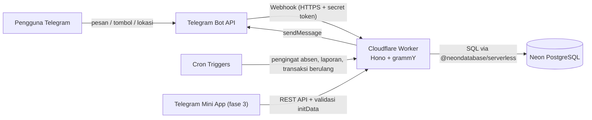
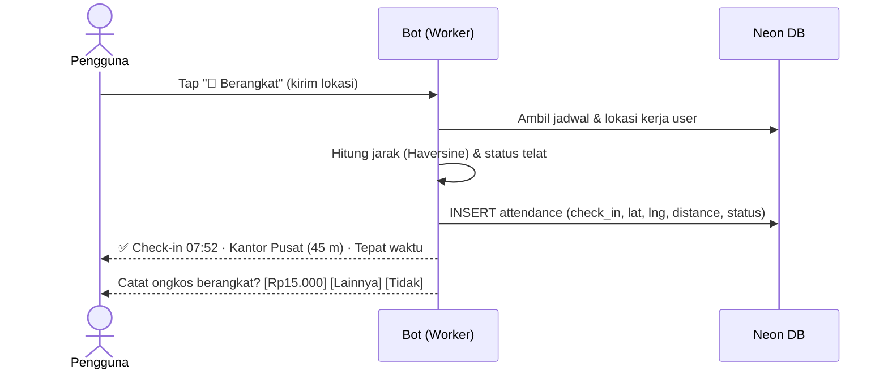
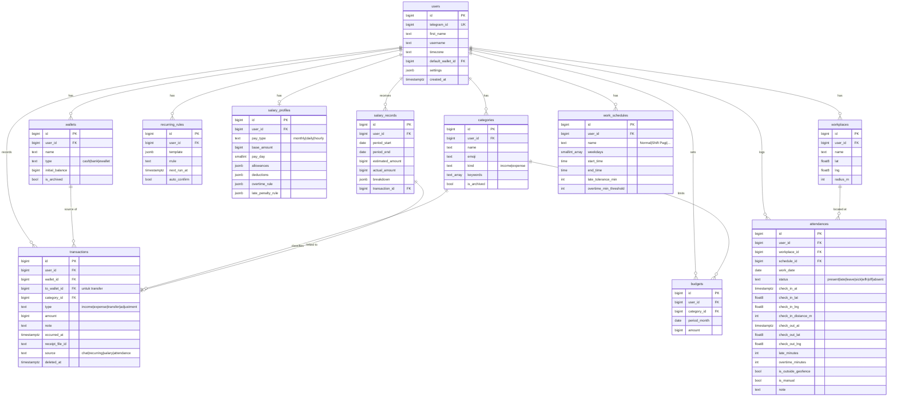
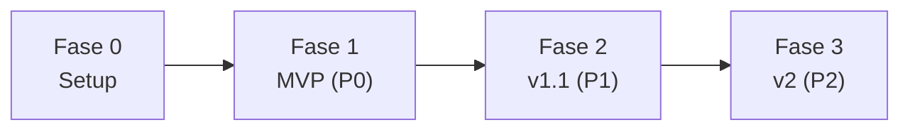

# PRD — Bot Telegram "Daily": Catatan Keuangan & Absensi Kerja

| Item | Detail |
|---|---|
| Nama produk | **Daily Bot** (nama kerja, bisa diganti) |
| Versi dokumen | 1.0 (Draft) |
| Tanggal | 8 November 2026 |
| Platform | Telegram Bot (chat) + Telegram Mini App (fase lanjutan) |
| Database | Neon (Serverless PostgreSQL) |
| Status | Menunggu review |

---

## 1. Ringkasan

Daily Bot adalah asisten pribadi di Telegram untuk:

1. **Mencatat keuangan harian**: pemasukan, pengeluaran, transfer antar dompet, gaji, anggaran, dan laporan.
2. **Absen keberangkatan kerja**: pencatatan simpel harian apakah user **berangkat kerja** atau **tidak berangkat** (libur, izin, sakit, cuti).

Kedua modul ini **terhubung**:
- Total hari berangkat otomatis dipakai untuk menghitung tunjangan harian (uang makan/transport per kehadiran) atau total upah harian.
- Saat tap **"🚗 Berangkat"**, bot bisa langsung menawarkan opsi cepat: *"Catat ongkos/bensin hari ini?"* agar pengeluaran transportasi langsung tercatat.

## 2. Latar Belakang & Masalah

| Masalah | Dampak |
|---|---|
| Aplikasi keuangan butuh banyak langkah (buka app, pilih kategori, isi form) | Pengguna malas mencatat dan data jadi bolong |
| Pengeluaran kecil (parkir, kopi, jajan) mudah lupa | Uang "hilang" tanpa jejak |
| Tidak ada catatan pribadi soal kehadiran & lembur | Sulit memverifikasi slip gaji dari kantor |
| Data keuangan dan kehadiran terpisah di banyak tempat | Tidak ada gambaran utuh soal "kerja → penghasilan → pengeluaran" |

**Solusi:** Telegram sudah dibuka setiap hari. Satu pesan singkat seperti `kopi 18rb` atau satu tombol **"📍 Berangkat"** sudah cukup untuk mencatat.

## 3. Tujuan & Non-Tujuan

### 3.1 Tujuan
- Mencatat transaksi dalam **≤ 5 detik** dengan satu pesan.
- Absen berangkat/pulang dalam **≤ 2 tap**.
- Menyajikan laporan harian, mingguan, dan bulanan secara otomatis.
- Membantu pengguna mengontrol anggaran dan mencocokkan gaji dengan kehadiran.

### 3.2 Non-Tujuan (di luar cakupan v1)
- Bukan sistem HRIS/absensi resmi perusahaan (absen bersifat **pencatatan pribadi**).
- Tidak terhubung langsung ke rekening bank atau e-wallet (tanpa open banking).
- Tidak menangani investasi/saham secara detail.
- Tidak mendukung multi-mata uang di v1 (hanya IDR).

## 4. Target Pengguna & Persona

| Persona | Deskripsi | Kebutuhan utama |
|---|---|---|
| **Rina, 26, karyawan kantoran** | Gaji bulanan, sering lembur, bawa motor | Catat jajan cepat, rekap lembur, cek slip gaji |
| **Budi, 31, pekerja shift/pabrik** | Upah harian + uang makan, jadwal shift berganti | Absen per shift, estimasi upah mingguan |
| **Sari, 23, freelancer/part-time** | Penghasilan tidak tetap dari banyak sumber | Catat pemasukan per sumber, anggaran ketat |

## 5. Rekomendasi Teknologi (Backend)

### 5.1 Stack yang Direkomendasikan

| Lapisan | Pilihan | Alasan |
|---|---|---|
| Bahasa | **TypeScript** | Type-safe, ekosistem bot Telegram paling aktif |
| Framework bot | **grammY** | Framework bot Telegram paling modern dan terawat. Plugin lengkap (conversations, menu, session, i18n, rate-limiter, auto-retry), dukungan Bot API terbaru, dan bisa jalan di Node, Bun, Deno, maupun Cloudflare Workers |
| Runtime/Hosting | **Cloudflare Workers** (mode webhook) | Serverless, *cold start* hampir nol, gratis hingga 100rb request/hari, punya **Cron Triggers** untuk pengingat dan laporan terjadwal |
| HTTP router | **Hono** | Ringan, *native* di Workers, untuk endpoint webhook, health check, dan API Mini App |
| Database | **Neon PostgreSQL** | Serverless, *autoscaling*, *scale-to-zero*, ada fitur *branching* untuk dev/preview |
| Driver DB | **`@neondatabase/serverless`** (HTTP/WebSocket) | Dibuat khusus untuk lingkungan serverless/edge, tidak perlu koneksi TCP yang lama |
| ORM & migrasi | **Drizzle ORM + drizzle-kit** | Ringan, SQL-like, *type-safe*, dukungan Neon *first-class*, cocok di edge |
| Validasi | **Zod** | Validasi input dan parsing perintah |
| Tanggal/zona waktu | **date-fns + date-fns-tz** | Semua logika memakai `Asia/Jakarta` (bisa diubah per user) |
| Export | CSV (native) & XLSX (`exceljs`/`SheetJS`) | Laporan unduhan |
| Grafik (fase 2) | QuickChart API atau render di Mini App | Grafik pengeluaran dikirim sebagai gambar |
| Observabilitas | Sentry + Cloudflare Logs | Pelacakan error |
| CI/CD | GitHub Actions + Wrangler | Deploy otomatis, migrasi DB per environment |

> **Alternatif:** Jika ingin server biasa (bukan serverless), pakai **grammY + Node.js/Bun** di **Railway/Fly.io** dengan driver `postgres`/`pg` ke Neon (pakai *pooled connection string*). Kode bot tetap sama, hanya *adapter*-nya yang berbeda. Alternatif bahasa Python: **aiogram 3** + SQLAlchemy.

### 5.2 Arsitektur



### 5.3 Struktur Modul Kode (usulan)

```
src/
  index.ts              # entry Hono: /webhook, /health, /api/*
  bot/
    bot.ts              # inisialisasi grammY, middleware
    middleware/         # auth user, session, rate-limit, error handler
    modules/
      finance/          # handlers, parser nominal, keyboards
      salary/
      attendance/
      report/
      settings/
  cron/                 # reminder, daily summary, recurring tx
  db/
    schema.ts           # Drizzle schema
    migrations/
  lib/                  # money parser, geo (haversine), tz utils
```

## 6. Fitur & Kebutuhan Fungsional

Prioritas: **P0** = wajib MVP, **P1** = penting (v1.1), **P2** = pengembangan lanjutan.

### 6.1 Onboarding & Akun

| ID | Kebutuhan | Prioritas |
|---|---|---|
| ON-1 | `/start` mendaftarkan user otomatis berdasarkan `telegram_id` | P0 |
| ON-2 | Wizard awal: nama panggilan, zona waktu (default `Asia/Jakarta`), saldo awal dompet | P0 |
| ON-3 | Wizard kerja (opsional): lokasi kantor, jam masuk/pulang, hari kerja, toleransi telat | P0 |
| ON-4 | Wizard gaji (opsional): tipe gaji (bulanan/harian/per jam), nominal, tanggal gajian, tunjangan | P1 |
| ON-5 | Bot hanya bisa dipakai di **private chat**. Di grup, bot menolak dengan sopan | P0 |
| ON-6 | Mode *whitelist* (opsional, via env) untuk membatasi user yang boleh memakai bot | P0 |

### 6.2 Modul Keuangan

#### a. Pencatatan Transaksi

| ID | Kebutuhan | Prioritas |
|---|---|---|
| FN-1 | **Input cepat bahasa natural**: `makan siang 25rb`, `+gaji 5,5jt`, `bensin 30k`. Tanda `+` berarti pemasukan, tanpa tanda berarti pengeluaran | P0 |
| FN-2 | Parser nominal Indonesia: `25000`, `25.000`, `25rb`, `25k`, `1,5jt`, `1.5jt`, `2juta` | P0 |
| FN-3 | Kategori otomatis dari kata kunci (mis. "bensin" → Transportasi). Jika ragu, bot menampilkan **inline keyboard** pilihan kategori | P0 |
| FN-4 | Perintah eksplisit: `/keluar`, `/masuk` dengan alur percakapan bertahap | P0 |
| FN-5 | Setiap transaksi tersimpan dibalas dengan konfirmasi + tombol **✏️ Edit**, **🗑️ Hapus**, **↩️ Undo** | P0 |
| FN-6 | Backdate: `kemarin parkir 5rb` atau `/keluar 50rb 05/11 belanja` | P1 |
| FN-7 | Lampiran foto struk (disimpan sebagai `file_id` Telegram) | P1 |
| FN-8 | OCR struk otomatis (Gemini/Vision API) untuk mengisi nominal & toko | P2 |
| FN-9 | Catatan suara → transaksi (speech-to-text) | P2 |

#### b. Dompet / Akun

| ID | Kebutuhan | Prioritas |
|---|---|---|
| WL-1 | Banyak dompet: Tunai, Bank (BCA, BRI, dll), E-wallet (GoPay, OVO, DANA) | P0 |
| WL-2 | Dompet default untuk input cepat; bisa ditimpa dengan `@gopay`, mis. `kopi 18rb @gopay` | P0 |
| WL-3 | Transfer antar dompet: `/transfer 500rb bca gopay` (tidak dihitung sebagai pemasukan/pengeluaran) | P0 |
| WL-4 | `/saldo` menampilkan saldo semua dompet + total | P0 |
| WL-5 | Penyesuaian saldo (*adjustment*) jika berbeda dengan saldo riil | P1 |

#### c. Kategori & Anggaran

| ID | Kebutuhan | Prioritas |
|---|---|---|
| CT-1 | Kategori bawaan: Makan & Minum, Transportasi, Belanja, Tagihan, Kesehatan, Hiburan, Pendidikan, Keluarga, Sedekah, Lainnya. Pemasukan: Gaji, Bonus, Lembur, Freelance, Lainnya | P0 |
| CT-2 | User bisa tambah/ubah/arsip kategori + emoji | P1 |
| BG-1 | Anggaran bulanan per kategori: `/budget makan 1,5jt` | P1 |
| BG-2 | Notifikasi saat pemakaian anggaran mencapai 80% dan 100% | P1 |
| BG-3 | "Sisa uang aman per hari" sampai gajian berikutnya | P1 |

#### d. Transaksi Berulang & Hutang

| ID | Kebutuhan | Prioritas |
|---|---|---|
| RC-1 | Transaksi berulang (kos, cicilan, langganan) yang otomatis dicatat atau dikonfirmasi lewat tombol | P1 |
| DB-1 | Catat hutang/piutang + pengingat jatuh tempo | P2 |
| GL-1 | Target tabungan (*saving goals*) | P2 |

### 6.3 Modul Gaji

| ID | Kebutuhan | Prioritas |
|---|---|---|
| SL-1 | Profil gaji: tipe (bulanan / harian / per jam), gaji pokok, tanggal gajian | P0 |
| SL-2 | Komponen tetap: tunjangan (transport, makan per hari hadir), potongan (BPJS, PPh21 manual, kasbon) | P1 |
| SL-3 | Aturan lembur: tarif per jam (manual) atau perhitungan Depnaker (1/173 × upah bulanan, 1,5× jam pertama, 2× jam berikutnya) | P1 |
| SL-4 | Aturan potongan telat (opsional): nominal per kejadian atau per menit | P1 |
| SL-5 | `/estimasigaji`: estimasi gaji periode berjalan dari data absensi (hari hadir, lembur, telat) | P1 |
| SL-6 | Pengingat di hari gajian: "Sudah gajian? Catat sekarang" dengan tombol berisi nominal estimasi | P0 |
| SL-7 | Saat gaji dicatat, simpan rincian ke `salary_records` dan tampilkan selisih **estimasi vs aktual** | P1 |
| SL-8 | Riwayat gaji per bulan & grafik tren | P2 |

### 6.4 Modul Absensi Kerja (Keberangkatan Harian)

Prinsip: **Absen simpel 1 tap** — hanya mencatat apakah user **berangkat kerja** atau **tidak** pada suatu hari. Tanpa ribet GPS, tanpa check-out sore, tanpa hitung lembur per menit.

| ID | Kebutuhan | Prioritas |
|---|---|---|
| AT-1 | Tombol menu tetap (*reply keyboard*): **🚗 Berangkat**, **🏖️ Tidak Masuk**, **💸 Catat**, **📊 Laporan** | P0 |
| AT-2 | **Tap "🚗 Berangkat"**: langsung mencatat status `berangkat` untuk tanggal hari ini | P0 |
| AT-3 | Opsi integrasi ongkos: setelah tap Berangkat, bot menampilkan inline button: *"Catat ongkos berangkat? [Rp15.000] [Rp20.000] [Lainnya] [Lewati]"* | P0 |
| AT-4 | **Tap "🏖️ Tidak Masuk"**: bot menampilkan pilihan cepat status: `Libur`, `Izin`, `Sakit`, `Cuti` + input catatan opsional | P0 |
| AT-5 | Mencegah duplikat: satu status per tanggal (jika tap lagi di hari yang sama, bot mengonfirmasi update status) | P0 |
| AT-6 | Pengingat pagi otomatis (default 07:30): *"Selamat pagi! Apakah hari ini kamu berangkat kerja? [🚗 Berangkat] [🏖️ Tidak Masuk]"* | P0 |
| AT-7 | Rekap bulanan: total hari berangkat, libur, sakit, cuti | P0 |
| AT-8 | Backdate: bisa catat atau koreksi absen kemarin/tanggal lalu jika lupa | P1 |

### 6.5 Laporan & Notifikasi

| ID | Kebutuhan | Prioritas |
|---|---|---|
| RP-1 | `/hariini`: ringkasan transaksi + status absen hari ini | P0 |
| RP-2 | `/laporan [minggu\|bulan\|MM-YYYY]`: total masuk/keluar, saldo bersih, top 5 kategori, perbandingan dengan periode lalu | P0 |
| RP-3 | `/rekapabsen [bulan]`: hari hadir, telat (jumlah & total menit), izin/sakit/cuti, total jam kerja, total lembur | P0 |
| RP-4 | Ringkasan harian otomatis (jam bisa diatur, default 21:00) | P1 |
| RP-5 | Laporan bulanan otomatis di tanggal 1 | P1 |
| RP-6 | Export **CSV/XLSX** transaksi & absensi per periode (dikirim sebagai dokumen) | P1 |
| RP-7 | Grafik pie/bar sebagai gambar | P2 |
| RP-8 | **Telegram Mini App** dashboard: grafik interaktif, edit massal, kalender absensi | P2 |

### 6.6 Pengaturan & Privasi

| ID | Kebutuhan | Prioritas |
|---|---|---|
| ST-1 | `/pengaturan`: zona waktu, dompet default, jam pengingat, lokasi kerja, jadwal kerja | P0 |
| ST-2 | `/hapusdata`: hapus semua data user (konfirmasi 2 langkah) | P0 |
| ST-3 | `/export` seluruh data (portabilitas) | P1 |
| ST-4 | PIN/kunci untuk menampilkan saldo (opsional) | P2 |

## 7. Daftar Perintah Bot

| Perintah | Fungsi |
|---|---|
| `/start` | Daftar & onboarding |
| `/menu` | Tampilkan menu utama |
| *(teks bebas)* | Input cepat transaksi, mis. `bakso 15rb`, `+bonus 1jt @bca` |
| `/keluar` · `/masuk` | Catat pengeluaran/pemasukan bertahap |
| `/transfer` | Transfer antar dompet |
| `/saldo` | Saldo semua dompet |
| `/hariini` | Ringkasan hari ini |
| `/laporan` | Laporan keuangan periode |
| `/budget` | Atur & lihat anggaran |
| `/gaji` | Catat gaji / lihat profil gaji |
| `/estimasigaji` | Estimasi gaji periode berjalan |
| `/berangkat` · `/pulang` | Absen check-in / check-out |
| `/izin` · `/sakit` · `/cuti` · `/wfh` | Status kehadiran |
| `/rekapabsen` | Rekap absensi |
| `/export` | Unduh data CSV/XLSX |
| `/pengaturan` | Pengaturan |
| `/bantuan` | Panduan penggunaan |

## 8. Contoh Alur Pengguna

### 8.1 Input Cepat Pengeluaran
```
User : kopi susu 18rb @gopay
Bot  : ✅ Pengeluaran tercatat
       ☕ Makan & Minum · Rp18.000 · GoPay
       Sisa anggaran Makan & Minum: Rp642.000 (57%)
       [✏️ Edit] [🗑️ Hapus] [📂 Ganti Kategori]
```

### 8.2 Absen Berangkat


### 8.3 Absen Pulang
```
Bot  : 🏁 Check-out 18:40 · Kantor Pusat
       ⏱️ Durasi kerja: 10j 48m
       ⏰ Lembur: 1j 40m (estimasi +Rp96.000)
       📅 Bulan ini: 15 hari hadir · 2x telat · 6j 20m lembur
```

## 9. Model Data (Neon PostgreSQL)

### 9.1 Prinsip
- **Nominal uang disimpan sebagai `BIGINT` dalam rupiah penuh** (tanpa float) untuk menghindari error pembulatan.
- Semua waktu disimpan sebagai `TIMESTAMPTZ` (UTC). Konversi ke zona waktu user dilakukan di aplikasi.
- `work_date` (DATE) disimpan terpisah agar shift lintas tengah malam tetap terhitung di tanggal kerja yang benar.
- *Soft delete* (`deleted_at`) untuk transaksi agar fitur *undo* bisa jalan.
- Semua tabel punya `user_id`, dan setiap query **wajib** difilter berdasarkan `user_id`.

### 9.2 ERD



Tabel pendukung: `bot_sessions` (state percakapan grammY, `key TEXT PK, value JSONB`), `holidays` (tanggal merah nasional), `reminder_logs` (mencegah pengingat ganda), `audit_logs`.

### 9.3 Index & Constraint Penting
```sql
CREATE UNIQUE INDEX ON users (telegram_id);
CREATE INDEX ON transactions (user_id, occurred_at DESC) WHERE deleted_at IS NULL;
CREATE INDEX ON transactions (user_id, category_id, occurred_at);
CREATE UNIQUE INDEX ON attendances (user_id, work_date, schedule_id);
CREATE UNIQUE INDEX ON budgets (user_id, category_id, period_month);
ALTER TABLE transactions ADD CONSTRAINT amount_positive CHECK (amount > 0);
```

Saldo dompet dihitung dari `initial_balance + SUM(transaksi)`. Jika data membesar, tambahkan *materialized view* atau kolom cache saldo yang diperbarui dalam transaksi DB yang sama.

## 10. Kebutuhan Non-Fungsional

| Kategori | Kebutuhan |
|---|---|
| **Performa** | Balasan bot p95 < 1,5 detik. Handler webhook selesai < 10 detik (batas Telegram) |
| **Ketersediaan** | ≥ 99,5% uptime (mengikuti SLA Cloudflare & Neon) |
| **Keamanan** | Webhook diverifikasi dengan header `X-Telegram-Bot-Api-Secret-Token`. Secret disimpan di Wrangler secrets. Koneksi DB memakai TLS. Data Mini App divalidasi lewat HMAC `initData` |
| **Isolasi data** | Semua query difilter `user_id`. Opsional: Postgres Row Level Security |
| **Idempotensi** | Simpan `update_id` yang sudah diproses untuk mencegah pencatatan ganda saat Telegram *retry* |
| **Rate limit** | Plugin `@grammyjs/ratelimiter` (mis. 1 pesan/detik per user). Plugin `auto-retry` untuk error 429 |
| **Privasi** | Lokasi hanya disimpan saat absen. User bisa hapus semua data. Tidak ada data dijual atau dibagikan |
| **Zona waktu** | Default `Asia/Jakarta`, mendukung WITA/WIT |
| **Bahasa** | Bahasa Indonesia (v1), struktur i18n siap untuk English |
| **Backup** | Neon Point-in-Time Restore (sesuai paket) + export rutin mingguan |
| **Skalabilitas** | Target awal 1.000 user aktif. Arsitektur serverless bisa diskalakan tanpa ubah kode |

## 11. Job Terjadwal (Cron Triggers)

| Job | Frekuensi | Fungsi |
|---|---|---|
| `attendance-reminder` | Tiap 5 menit | Kirim pengingat check-in/check-out sesuai jadwal masing-masing user |
| `auto-absent` | Harian 23:55 WIB | Tandai `absent` jika hari kerja tanpa check-in maupun status izin |
| `recurring-tx` | Tiap jam | Proses `recurring_rules` yang jatuh tempo |
| `payday-reminder` | Harian 08:00 | Pengingat hari gajian + estimasi gaji |
| `daily-summary` | Tiap 15 menit (cek jam per user) | Ringkasan harian |
| `monthly-report` | Tanggal 1, 07:00 | Laporan bulanan |
| `budget-alert` | Saat transaksi dicatat (event-driven) | Peringatan anggaran 80%/100% |

> Pengiriman massal memakai antrean (Cloudflare Queues) atau *batch* dengan jeda untuk mematuhi limit Telegram (~30 pesan/detik).

## 12. Metrik Keberhasilan

| Metrik | Target 3 bulan |
|---|---|
| Retensi D30 | ≥ 40% |
| Rata-rata transaksi tercatat / user aktif / hari | ≥ 3 |
| Kepatuhan absen (hari kerja dengan check-in) | ≥ 85% |
| Akurasi parser input cepat (tanpa koreksi) | ≥ 90% |
| Rata-rata waktu respons bot | < 1 detik |
| Error rate handler | < 0,5% |

## 13. Rencana Rilis

| Fase | Durasi | Cakupan |
|---|---|---|
| **Fase 0 — Setup** | 3 hari | Repo, Wrangler, Neon (branch `main` & `dev`), Drizzle schema & migrasi, CI/CD, webhook |
| **Fase 1 — MVP** | 2–3 minggu | Semua item **P0**: onboarding, input cepat, dompet, transfer, saldo, absen check-in/out + geofence, izin/sakit, pengingat absen, pengingat gajian, laporan dasar, hapus data |
| **Fase 2 — v1.1** | 2 minggu | Item **P1**: anggaran, transaksi berulang, profil gaji lengkap + lembur + estimasi gaji, shift, multi-lokasi, export CSV/XLSX, ringkasan otomatis, libur nasional |
| **Fase 3 — v2** | 3–4 minggu | Item **P2**: Mini App dashboard, grafik, OCR struk, voice note, hutang/piutang, target tabungan |



## 14. Risiko & Mitigasi

| Risiko | Dampak | Mitigasi |
|---|---|---|
| Lokasi palsu (fake GPS) | Absen tidak akurat | Absensi diposisikan sebagai catatan pribadi, flag di luar geofence, opsi live location / selfie di fase lanjutan |
| Parser salah membaca nominal/kategori | Data keliru | Konfirmasi + tombol edit/undo, belajar dari koreksi user (simpan keyword ke kategori) |
| Cold start Neon (scale-to-zero) | Respons pertama lambat (~0,5–1 detik) | Gunakan driver HTTP Neon. Atur *suspend timeout* lebih panjang di production jika perlu |
| Batas CPU Cloudflare Workers | Export besar gagal | Pecah export per bulan, gunakan paket Workers Paid atau proses lewat Queue |
| Rate limit Telegram saat broadcast cron | Pengingat telat/gagal | Antrean + throttle + auto-retry |
| User lupa check-out | Jam kerja/lembur salah | Pengingat check-out + koreksi manual + auto-close dengan flag |
| Kebocoran data keuangan | Kepercayaan hilang | Secret management, isolasi `user_id`, audit log, minim data sensitif (tidak menyimpan nomor rekening) |

## 15. Pertanyaan Terbuka

1. Bot ini untuk **pribadi** (1 user/whitelist) atau **publik** (siapa saja bisa daftar)?
2. Apakah perlu fitur **tim/atasan** (atasan melihat rekap absen anggota) di masa depan?
3. Perhitungan lembur pakai **aturan Depnaker** atau tarif manual saja?
4. Apakah perlu **multi-mata uang** atau cukup IDR?
5. Hosting: setuju dengan **Cloudflare Workers**, atau lebih suka server biasa (Railway/Fly.io/VPS)?
6. Perlu **Mini App** sejak awal atau cukup chat dulu?

---

## Lampiran A — Aturan Parser Nominal

| Input | Hasil |
|---|---|
| `25000` / `25.000` / `25,000` | 25.000 |
| `25rb` / `25ribu` / `25k` | 25.000 |
| `1,5jt` / `1.5jt` / `1,5 juta` | 1.500.000 |
| `2jt500` | 2.500.000 |
| `+gaji 5jt` | Pemasukan 5.000.000, kategori Gaji |
| `kopi 18rb @gopay` | Pengeluaran 18.000, dompet GoPay |
| `kemarin parkir 5rb` | Pengeluaran 5.000, tanggal H-1 |

## Lampiran B — Variabel Environment

```
BOT_TOKEN=
WEBHOOK_SECRET=
DATABASE_URL=postgresql://...neon.tech/neondb?sslmode=require
ALLOWED_TELEGRAM_IDS=        # opsional, mode whitelist
DEFAULT_TIMEZONE=Asia/Jakarta
SENTRY_DSN=
```

